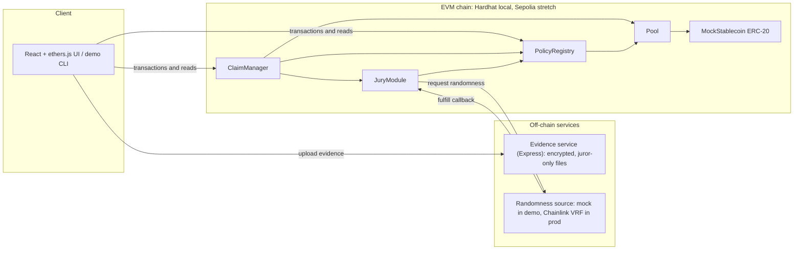
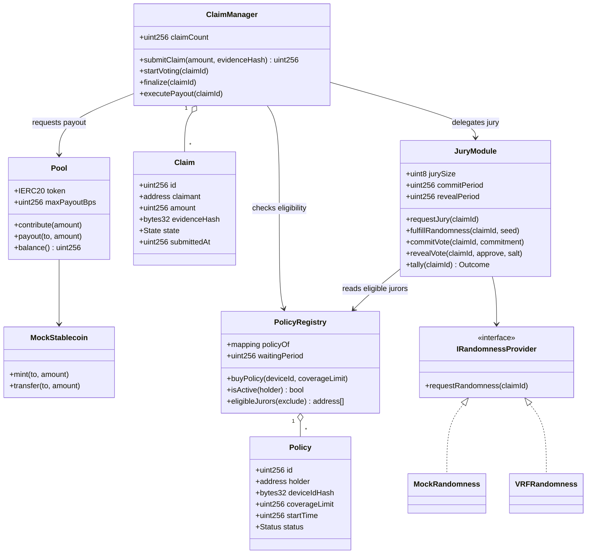
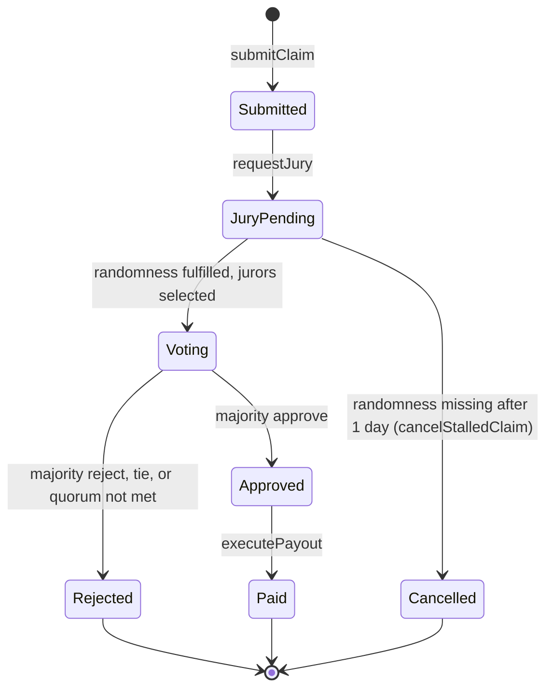
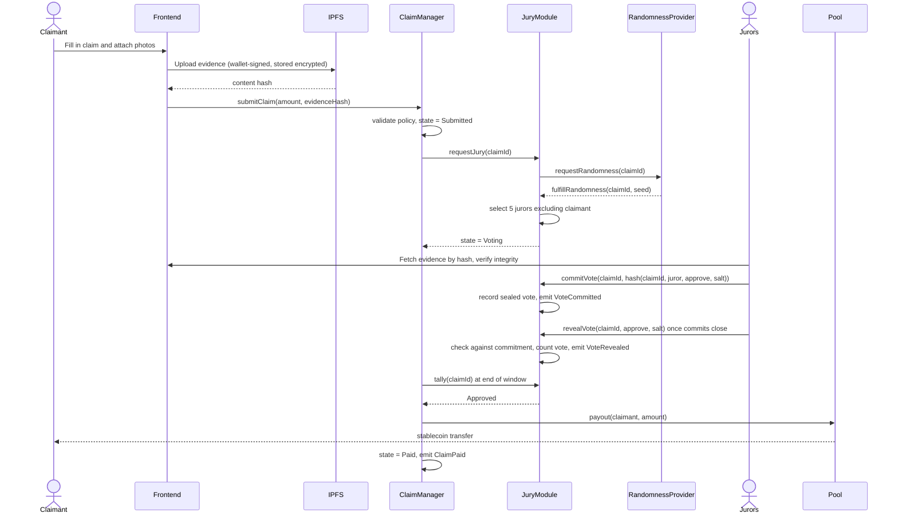
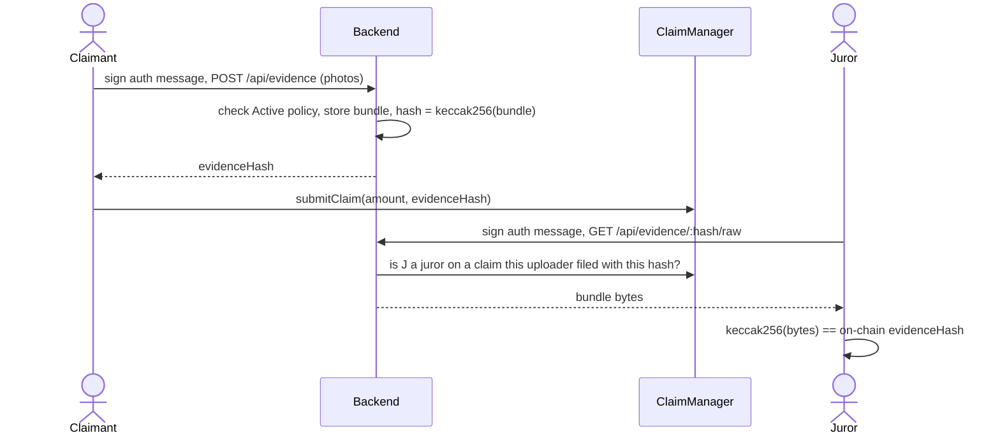

# P2P Device Insurance: System Design Document (Milestone 2)

## 1. Overview

A peer-to-peer device insurance protocol on an EVM blockchain. Policyholders contribute stablecoin to a shared pool. When a policyholder files a claim, a randomly selected jury of other policyholders votes on it. If the jury approves, the pool pays out. Payments and votes are recorded on-chain as an immutable audit trail.

**Goals for this milestone:** one working happy-path claim flow, end to end, on a local network.

**Non-goals (see Section 10):** production-grade randomness, Sybil resistance, appeals, solvency modeling, regulatory structure.

## 2. Architecture at a Glance

The system has three layers: a client, a set of on-chain contracts, and off-chain services for evidence storage and randomness.



### Why this shape

- **Separate contracts by responsibility.** Money (Pool), membership (PolicyRegistry), claim workflow (ClaimManager), and jury logic (JuryModule) each change for different reasons. Keeping jury logic separate means we can swap in a better selection or voting scheme without touching the contract that holds funds.
- **Only the Pool moves money.** Every other contract has zero token custody, which shrinks the attack surface and makes audits easier.
- **Evidence stays off-chain.** Only a content hash goes on-chain. This keeps gas low, avoids putting personal data on an immutable ledger, and lets jurors verify the file has not been altered since submission.
- **Randomness is behind an interface.** The demo uses a mock; production swaps in Chainlink VRF with no changes to JuryModule.

## 3. Component Responsibilities

| Component | Responsibility | Holds funds? |
|---|---|---|
| **MockStablecoin** | ERC-20 for the demo; stands in for USDC | n/a |
| **PolicyRegistry** | Creates policies, tracks status (Active, Lapsed), enforces one policy per wallet, exposes the eligible-juror list | No |
| **Pool** | Accepts contributions, holds the stablecoin, executes payouts (callable only by ClaimManager) | **Yes** |
| **ClaimManager** | Owns the claim state machine, validates eligibility, triggers jury selection, finalizes outcomes, requests payout | No |
| **JuryModule** | Requests randomness, selects jurors, runs commit-reveal voting, tallies revealed votes | No |
| **IRandomnessProvider** | Interface: `requestRandomness(claimId)`. Implementations: `MockRandomness` (demo), `VRFRandomness` (future) | No |
| **Frontend / CLI** | Wallet connection, evidence upload, claim submission, voting, status views | n/a |

## 4. Data Model



## 5. Claim Lifecycle



**Transition rules**

| Transition | Guard |
|---|---|
| Submit | Policy is Active, waiting period elapsed, amount at most the coverage limit, no other open claim on this policy |
| Submitted to JuryPending | Called by ClaimManager after submission |
| JuryPending to Voting | Only the randomness provider can call the fulfill callback, and only the first callback seats a jury |
| JuryPending to Cancelled | Anyone, once randomness has been pending longer than `randomnessTimeout` (1 day). The policy is freed so the holder can file again, and a late callback reverts |
| Commit | Caller is a selected juror, has not committed, commit window (2 days from selection) still open. The commitment is `keccak256(abi.encode(claimId, juror, approve, salt))`, so it reveals nothing and cannot be reused by another juror or claim |
| Reveal | Caller committed and has not revealed; the commit window has ended or every juror has committed; reveal window (1 day after the commit window) still open; `(approve, salt)` matches the commitment |
| Finalize | Reveal window ended or every juror revealed. Only revealed votes count; a commit that is never revealed counts as no vote. Approved only if at least 3 votes were revealed and approvals strictly outnumber rejections. A tie (for example 2-2) and fewer than 3 votes both end in Rejected; nothing is retried |
| Approved | The payout is fixed here: the minimum of the claim amount, the coverage limit, and the per-claim cap (`maxPayoutBps`, 20% of the pool balance at this moment). Later pool movements do not change it |
| Paid | Pays the fixed amount. If the pool holds less than that, the call reverts and the claim stays Approved until funds arrive; approved claims are paid first come, first served (no pro-rata) |

## 6. Main Flow



## 6a. Access Control

Which contract may call which privileged function. All wiring is one-time: each setter reverts with `AlreadySet` after its first call, so no address can be swapped after deployment. Replacing the JuryModule therefore means redeploying ClaimManager and Pool wiring too (a deliberate trade: no admin can redirect payouts later; upgradeability is future work #11).

| Function | Only callable by | Set by |
|---|---|---|
| `Pool.collectPremium` | PolicyRegistry | `Pool.setRegistry` (owner, once) |
| `Pool.payout` | ClaimManager | `Pool.setClaimManager` (owner, once) |
| `JuryModule.requestJury`, `tally`, `cancel` | ClaimManager | `JuryModule.setClaimManager` (owner, once) |
| `JuryModule.fulfillRandomness` | The randomness provider | Constructor (immutable) |
| `ClaimManager.startVoting` | JuryModule | Constructor (immutable) |
| `MockRandomness.fulfill` | MockRandomness owner (the deployer / backend keeper) | Constructor |
| `PolicyRegistry.lapsePolicy` | PolicyRegistry owner | Constructor |
| `ClaimManager.finalize`, `executePayout`, `cancelStalledClaim` | Anyone (guarded by claim state and timing) | n/a |

## 6b. Off-chain Backend and Evidence Privacy

The Express backend stores evidence, runs a keeper, and serves read-only views of on-chain state. It never holds user keys.

**Evidence policy.** Evidence is private, not public IPFS.
- Uploading requires a wallet signature from a holder with an Active policy.
- A bundle is served only to (a) the wallets that uploaded it and (b) the selected jurors of a claim that one of those uploaders filed with it, and to jurors only while that claim is in Voting. Other members, past jurors and anonymous callers get nothing. Copying a hash from the chain and filing a claim with it grants nothing.
- Requests are authenticated with a signed, timestamped message (EIP-191, valid 10 minutes); there are no passwords or sessions.
- Every bundle is encrypted at rest with AES-256-GCM under the backend's evidence key (`EVIDENCE_ENCRYPTION_KEY`; on a local chain a key file is generated). The evidence hash is bound as authenticated data, so a file swapped or altered on disk fails to decrypt. The hash on-chain is of the plaintext, so jurors still verify it after download.
- Trust boundary: the backend holds the key and decrypts for authorized readers, so its operator could read evidence. End-to-end encryption to each juror's own key was not chosen because jurors are unknown when evidence is uploaded and MetaMask has deprecated its encryption API; it remains future work #9.
- Retention: files are kept on the backend's disk for the life of the deployment, so they stay available through the voting window. There is no automatic deletion yet.
- The on-chain hash proves the evidence has not changed since the claim was filed. It does not prove the claim is true; that is what the jury decides.



**Keeper.** Polls open claims. It fulfils randomness (as the MockRandomness owner, with a CSPRNG seed), cancels claims whose randomness timed out, finalizes when voting has closed, and pays approved claims. Everything except fulfilment is permissionless, so the keeper saves users transactions but cannot change an outcome.

**Randomness trust.** With MockRandomness the owner chooses the seed and could pick a favourable jury. The prototype makes no claim of unbiased selection. Migration: deploy a `VRFRandomness` adapter implementing `IRandomnessProvider` on Sepolia (Chainlink VRF v2.5), pass it to a new JuryModule, and drop the keeper's fulfilment step; the timeout and cancel path already cover a callback that never arrives.

## 7. Key Design Decisions

| Decision | Choice | Rationale | Alternative considered |
|---|---|---|---|
| Contract structure | 4 focused contracts | Separation of concerns, upgrade path, easier testing | One monolith: simpler, but tangled and harder to audit |
| Fund custody | Pool only | Smallest attack surface | Escrow per claim: more gas and complexity |
| Randomness | Interface with mock, VRF later | Deterministic tests now, real randomness later | Blockhash: manipulable by validators |
| Jury selection | Fisher-Yates style sampling on the eligible list, seeded by the randomness output | Simple and auditable; fine for a small demo pool | Off-chain selection: cheaper but requires trusting the selector |
| Voting | Commit-reveal: sealed votes for 2 days, then 1 day to reveal | No juror can see or copy another's vote before committing, which removes herding | Plain on-chain vote: one transaction per juror, but later jurors see earlier votes |
| Commit-reveal salt | Chosen by the juror's wallet; the frontend should derive it from a wallet signature over the claim id so it can be recovered | A lost salt means a vote cannot be revealed; deriving it avoids storing secrets | Backend stores salts: convenient, but the backend could then read every vote early |
| Payout cap timing | Fixed when the jury approves | The claimant's payout cannot move after the verdict | At payout time: simpler, but other claims or contributions could change the amount |
| Stalled randomness | Cancel after 1 day, policy freed to refile | Claims never get stuck; a late callback cannot seat a second jury | Retry the request: keeps the claim alive but needs the provider to accept duplicates |
| Evidence access | Uploader plus that claim's jurors, wallet-signed requests | Jurors can review without making personal media public | Public IPFS: simpler but exposes photos to everyone |
| Evidence | Hash on-chain, file on IPFS | Cheap, tamper-evident, privacy-friendlier | Full on-chain storage: expensive and permanently public |
| Token | Mock ERC-20 | Free and controllable for demos | Real USDC on testnet: extra setup with little benefit at this stage |
| Access control | OpenZeppelin `Ownable` and role checks between contracts | Battle-tested primitives | Custom modifiers: more bug risk |

**Why these parameters.** They are demo values chosen so the whole flow fits in a test run and a small class demo, not actuarial figures. 5% premium makes premiums visible against a 2,000 mUSDC coverage maximum. 7-day waiting period is short enough to fast-forward in tests while still blocking "buy then claim immediately". A jury of 5 with quorum 3 works with the 6 to 8 wallets a local Hardhat demo has; odd size avoids ties when everyone votes. A 2-day commit and 1-day reveal window (3 days in all) give jurors time without stalling the demo; once every juror has committed, reveals open immediately. 20% per-claim cap means no single claim can take more than a fifth of the pool. 1-day randomness timeout is far longer than VRF normally takes.

## 8. Trust Assumptions and Threats (Prototype)

| Threat | Prototype mitigation | Production plan |
|---|---|---|
| One person creates many wallets to dominate juries | One policy per wallet, waiting period | Identity or device attestation, stake-weighted selection |
| Claimant sits on their own jury | Claimant excluded from selection | Also exclude linked accounts |
| Jurors copy each other's votes | Commit-reveal: votes are sealed until every juror has committed or the commit window ends | Juror incentives for honest reveals |
| Juror never reveals | Unrevealed commits count as no vote; quorum rule rejects the claim if too few reveal | Slash non-revealers |
| Randomness is predicted or gamed | Mock only, clearly labeled | Chainlink VRF |
| Pool drained by a single large claim | Coverage limit and `maxPayoutBps` cap | Solvency modeling, reserve ratios, pro-rata payouts |
| Reentrancy on payout | Checks-effects-interactions, OpenZeppelin `ReentrancyGuard` | External audit |
| Non-voting jurors stall a claim | Voting deadline and quorum rule | Slash non-voters, replace with fresh jurors |
| Randomness never arrives | Anyone can cancel after 1 day; the holder can refile | VRF subscription monitoring |
| Evidence leaks to other members | Backend serves it only to the uploader and, during voting, that claim's jurors | Encrypt to juror keys |
| Evidence disk or backup is copied | AES-256-GCM encryption at rest | Key management service, key rotation |
| Device ID guessed from its hash | None: `keccak256(IMEI)` can be brute-forced for known IMEI ranges | Salt the device hash per policy |
| Jurors collude or don't care | None: there is no juror reward or stake in the MVP, so the protocol makes no anti-collusion claim | Juror stake, coherence rewards |
| One policyholder claims again and again | None: the coverage limit caps each claim, but a paid claim does not reduce it | Lifetime coverage limit, each payout deducted (§10a) |
| The same damage is claimed twice | None: a new claim can reuse the old evidence, and jurors see only the current claim | Jurors see the policy's claim history and earlier evidence (§10a) |

## 9. Testing and CI

- **Unit tests** (Hardhat + Chai) per contract, covering guards and state transitions.
- **Integration test** that runs the full happy path: join, contribute, submit, vote, payout.
- **Negative tests:** ineligible claimant, double commit and double reveal, non-juror vote, reveal not matching the commitment, commit or reveal after its window, payout above the pool balance, evidence read by a non-juror or with a wrong key.
- **CI (GitHub Actions):** install dependencies, compile, run tests, lint (Solhint and ESLint). Branch protection requires a green run before merge.

## 10. Limitations and Future Work

These are known gaps, deliberately left out of the prototype.

1. **Bribery resistance** beyond commit-reveal (which is built): votes become public on reveal, so a briber can still check them afterwards
2. **Appeals** with escalating jury sizes
3. **Juror incentives:** fees, coherence rewards, and penalties for non-voters
4. **Real randomness** via Chainlink VRF or drand
5. **Sybil resistance:** identity checks or device attestation (IMEI, Apple and Google attestation)
6. **Claimant bond** forfeited on fraudulent claims
7. **Solvency modeling:** reserve ratios, pro-rata payouts on shortfall, withdrawal lockups
8. **Gas-efficient jury selection** for large pools (off-chain selection with on-chain proof)
9. **End-to-end evidence encryption** to each juror's key, so even the backend cannot read evidence (encryption at rest and juror-only access are built)
10. **Regulatory structure**, since this resembles insurance in most jurisdictions (a discretionary-mutual model is one path)
11. **Upgradeability,** timelocks, and an emergency pause

## 10a. Feature-complete Plan: Closing Loopholes

The goal for the feature-complete milestone is to close the ways the MVP can be gamed, not to add new surface. Agreed so far:

| Loophole | Today (MVP) | Planned fix | Touches |
|---|---|---|---|
| Repeat claims | `coverageLimit` caps each claim; a paid claim leaves it unchanged, so a holder can keep claiming | Make `coverageLimit` a lifetime total per policy. `executePayout` deducts the paid amount; `submitClaim` checks the request against what remains; the policy is exhausted at zero | `PolicyRegistry`, `ClaimManager`, dashboard |
| Duplicate claims | A new claim can reuse earlier evidence, and jurors see only the claim in front of them | Show jurors the policy's earlier claims (amount, outcome, date) and let them open that earlier evidence while the new claim is in Voting, so they can judge whether it is the same damage | Backend evidence access rules, claim detail and jury screens |
| Biased jury selection | The keeper owns `MockRandomness` and chooses the seed | `VRFRandomness` adapter (Chainlink VRF v2.5) on Sepolia, as in §6b | New adapter, deploy config |
| Jurors with nothing at stake | No juror reward or penalty | Design juror stakes and coherence rewards (future work 3); build only if time allows | `PolicyRegistry`, `JuryModule` |

Considered and not planned:
- **Rejecting a reused evidence hash on-chain.** Cheap to add, but any re-saved or re-encoded photo produces a new hash, so it stops only the laziest duplicate. Human review of the claim history covers it.
- **Automatic near-duplicate image detection** (perceptual hashing in the backend). Too much effort for this milestone; jurors comparing evidence covers the same risk.

Also planned: readable contract error messages in the frontend (it currently shows "unknown custom error") and browser end-to-end tests.

## 11. Repository Layout

```
/contracts
  MockStablecoin.sol
  PolicyRegistry.sol
  Pool.sol
  ClaimManager.sol
  JuryModule.sol
  interfaces/IRandomnessProvider.sol
  mocks/MockRandomness.sol
/test
  integration/happyPath.test.js
  unit/*.test.js
/scripts
  deploy.js
  demo.js
/frontend
/docs
  design-doc.md
  tech-stack-justification.md
/.github/workflows
  ci.yml
```
