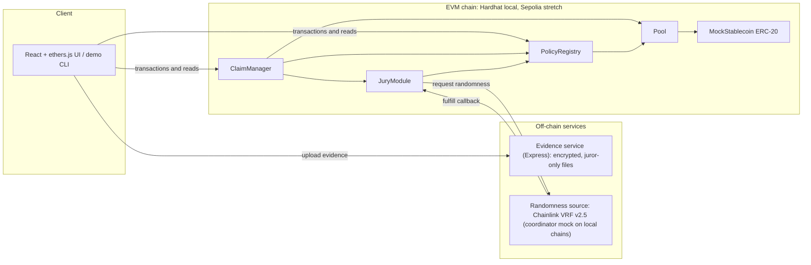
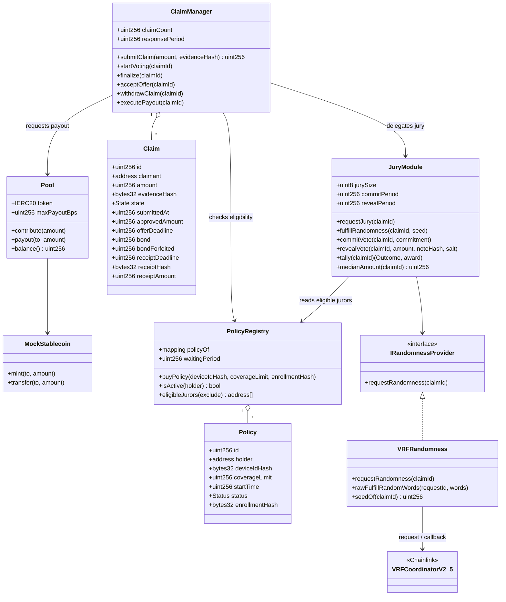
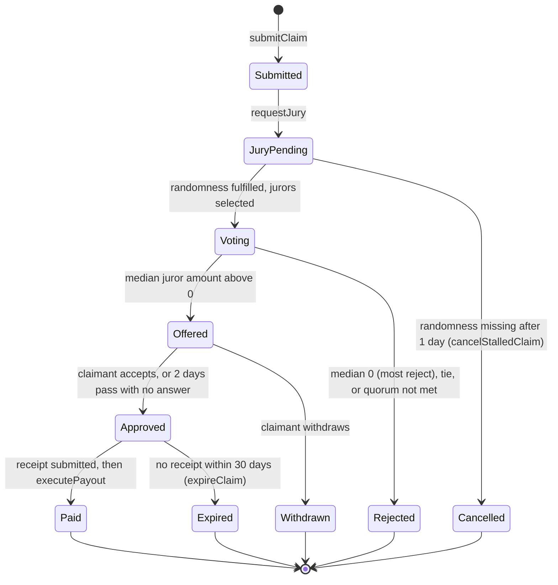
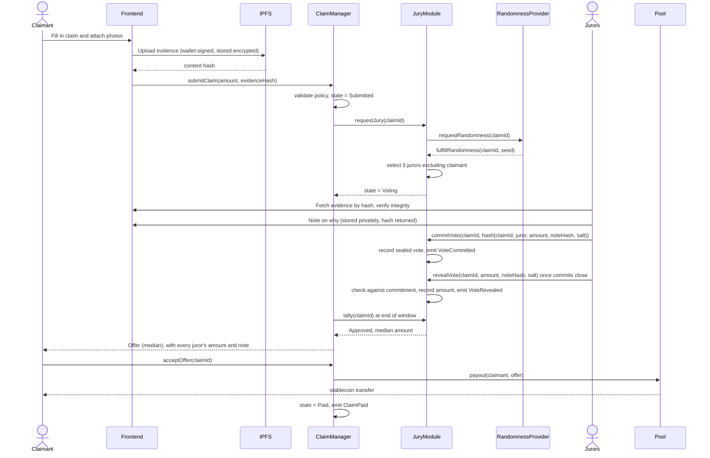
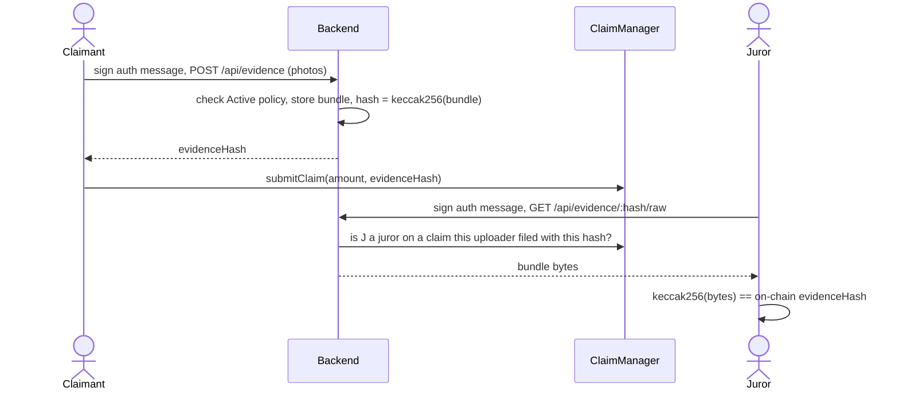

# P2P Device Insurance: System Design Document (Milestone 2)

## 1. Overview

A peer-to-peer device insurance protocol on an EVM blockchain. Policyholders contribute stablecoin to a shared pool. When a policyholder files a claim, a randomly selected jury of other policyholders votes on it. If the jury approves, the pool pays out. Payments and votes are recorded on-chain as an immutable audit trail. A jury approval is the jurors' judgment of the evidence, not proof that the claim is legitimate; there is no oracle feed for claims. See [oracle-and-anti-fraud.md](oracle-and-anti-fraud.md) for the oracle decision and what the anti-fraud measures do and do not show.

**Goals for this milestone:** one working happy-path claim flow, end to end, on a local network.

**Non-goals (see Section 10):** a claim oracle (deferred), objective tests of collusion resistance, Sybil resistance, appeals, solvency modeling, regulatory structure.

## 2. Architecture at a Glance

The system has three layers: a client, a set of on-chain contracts, and off-chain services for evidence storage and randomness.



### Why this shape

- **Separate contracts by responsibility.** Money (Pool), membership (PolicyRegistry), claim workflow (ClaimManager), and jury logic (JuryModule) each change for different reasons. Keeping jury logic separate means we can swap in a better selection or voting scheme without touching the contract that holds funds.
- **Only the Pool moves money.** Every other contract has zero token custody, which shrinks the attack surface and makes audits easier.
- **Evidence stays off-chain.** Only a content hash goes on-chain. This keeps gas low, avoids putting personal data on an immutable ledger, and lets jurors check the file has not been altered since submission. That is integrity only: the hash says nothing about whether the photos are genuine.
- **Randomness is behind an interface.** `VRFRandomness` implements it with Chainlink VRF v2.5. Local chains use Chainlink's official coordinator mock; Sepolia uses Chainlink's real coordinator. JuryModule does not know which.

## 3. Component Responsibilities

| Component | Responsibility | Holds funds? |
|---|---|---|
| **MockStablecoin** | ERC-20 for the demo; stands in for USDC | n/a |
| **PolicyRegistry** | Creates policies, collects monthly premiums (with a grace period), tracks status (Active, Lapsed), enforces one policy per wallet, exposes the eligible-juror list | No |
| **Pool** | Accepts contributions, holds the stablecoin, executes payouts (callable only by ClaimManager) | **Yes** |
| **ClaimManager** | Owns the claim state machine, validates eligibility, triggers jury selection, finalizes outcomes, requests payout | No |
| **JuryModule** | Requests randomness, selects jurors, runs commit-reveal voting, tallies revealed votes | No |
| **IRandomnessProvider** | Interface: `requestRandomness(claimId)`. Implementation: `VRFRandomness` (Chainlink VRF v2.5, no owner, immutable coordinator) | No |
| **Frontend / CLI** | Wallet connection, evidence upload, claim submission, voting, status views | n/a |

## 4. Data Model



## 5. Claim Lifecycle



**Transition rules**

| Transition | Guard |
|---|---|
| Submit | Policy is Active with premiums paid or in their grace period, waiting period elapsed, amount at most the coverage limit, no other open claim on this policy. The claimant posts a bond (5% of the amount, at least 5 mUSDC), held by the Pool outside the reserve |
| Submitted to JuryPending | Called by ClaimManager after submission |
| JuryPending to Voting | Only the Chainlink VRF coordinator can deliver the word to `VRFRandomness`, which forwards it to JuryModule in the same transaction; only the first delivery counts. If fewer than `jurySize` members are still eligible at that moment, no jury is seated: the claim is marked starved and can be cancelled immediately |
| JuryPending to Cancelled | Anyone, once randomness has been pending longer than `randomnessTimeout` (1 day), or at once if the claim was starved of jurors. The policy is freed so the holder can file again, a late callback cannot seat a jury, and the bond is returned in full |
| Commit | Caller is a selected juror, has not committed, commit window (2 days from selection) still open. The commitment is `keccak256(abi.encode(claimId, juror, amount, noteHash, salt))`, so it reveals nothing and cannot be reused by another juror or claim. `amount` is what the juror would pay (0 rejects); `noteHash` is the hash of their written reasoning, kept by the backend |
| Reveal | Caller committed and has not revealed; the commit window has ended or every juror has committed; reveal window (1 day after the commit window) still open; `(amount, noteHash, salt)` matches the commitment; `amount` is at most the amount asked |
| Finalize | Reveal window ended or every juror revealed. Only revealed votes count; a commit that is never revealed counts as no vote. The offer is the median revealed amount (the lower middle one for an even count). Approved only if at least 3 votes were revealed and the median is above 0, which is the same as strictly more jurors paying than rejecting. A tie (for example 2-2) and fewer than 3 votes both end in Rejected; nothing is retried. The bond is settled here: the claimant gets it back minus the share of the ask the jury cut (bond × (asked − median) / asked), measured against the median before any pool cap. Without quorum the whole bond is returned |
| Offered | The offer is fixed here: the minimum of the median, the coverage limit, and the per-claim cap (`maxPayoutBps`, 20% of the pool balance at this moment). Later pool movements do not change it. The claimant sees every juror's amount and note |
| Accept / Withdraw | The claimant accepts (to Approved) or withdraws (to Withdrawn, nothing paid, policy freed) within `responsePeriod` (2 days). After it, anyone may accept; the keeper does. There is no counteroffer |
| Receipt | Only the claimant, once, within `receiptPeriod` (30 days) of accepting: the hash of the encrypted receipt bundle (shop, total, date, invoice files) and its total. The payout becomes the smaller of the offer and the total. The backend takes a receipt only for the claimant's own accepted claim, and refuses a file already used for another claim |
| Approved to Expired | Anyone, once the receipt window has passed with no receipt; nothing is paid and the policy is freed. The keeper does it |
| Paid | Needs the receipt. Pays the smaller of the fixed offer and the receipt. If the pool holds less than that, the call reverts and the claim stays Approved until funds arrive; approved claims are paid first come, first served (no pro-rata) |

## 6. Main Flow



## 6a. Access Control

Which contract may call which privileged function. All wiring is one-time: each setter reverts with `AlreadySet` after its first call, so no address can be swapped after deployment. Replacing the JuryModule therefore means redeploying ClaimManager and Pool wiring too (a deliberate trade: no admin can redirect payouts later; upgradeability is future work #11).

| Function | Only callable by | Set by |
|---|---|---|
| `Pool.collectPremium` | PolicyRegistry | `Pool.setRegistry` (owner, once) |
| `Pool.payout` | ClaimManager | `Pool.setClaimManager` (owner, once) |
| `JuryModule.requestJury`, `tally`, `cancel` | ClaimManager | `JuryModule.setClaimManager` (owner, once) |
| `JuryModule.fulfillRandomness` | The randomness provider | Constructor (immutable) |
| `ClaimManager.startVoting` | JuryModule | Constructor (immutable) |
| `VRFRandomness.requestRandomness` | JuryModule | `VRFRandomness.setConsumer` (deployer, once) |
| `VRFRandomness.rawFulfillRandomWords` | The Chainlink VRF coordinator | Constructor (immutable) |
| `PolicyRegistry.lapsePolicy` | PolicyRegistry owner | Constructor |
| `ClaimManager.finalize`, `executePayout`, `cancelStalledClaim` | Anyone (guarded by claim state and timing) | n/a |

## 6b. Off-chain Backend and Evidence Privacy

The Express backend stores evidence, runs a keeper, and serves read-only views of on-chain state. It never holds user keys.

**Device photos.** Each claim is checked against the phone registered at signup.
- At signup the member picks the device type (phone, tablet, laptop, camera or other) and enters the serial number, make, model and colour, plus the IMEI for a phone (checked with its Luhn digit; optional for a tablet). They take three photos: the front, the back, and where the device shows its serial (Settings > About on a phone or tablet, the label on other devices). These go to the backend as an "enrollment" bundle, and its hash is stored on the policy (`enrollmentHash`). The policy's `deviceIdHash` is `keccak256(IMEI)`, or `keccak256("make:SERIAL")` for a device without an IMEI, since serials are only unique per manufacturer.
- Before taking photos, at signup or for a claim, the app requests a one-time capture code (`POST /api/capture/code`) that should appear in the first photo. The backend stamps the bundle with the code and when it was issued and received, and refuses a code that is missing, expired (15 minutes), used, or issued to another wallet. This shows the photos were taken after the code was issued rather than found online. It does not show the device is the member's or that any damage is real.
- Jurors see the signup photos and the claim photos side by side, with automatic checks: do the signup details hash to the policy's `deviceIdHash`, and does the IMEI or serial given with the claim (optional) match the signup one. The frontend warns if a claim was filed with the signup bundle instead of new photos.
- Limits: a web app cannot stop someone uploading an old photo instead of using the camera, so the capture code is the freshness check. A device that is already broken inside but looks fine at signup is not caught; the waiting period is the main defence there.

**Evidence policy.** Evidence is private, not public IPFS.
- Uploading claim evidence requires a wallet signature from a holder with an Active policy. Enrollment bundles only need a signature, since they come before the policy exists.
- A bundle is served only to (a) the wallets that uploaded it and (b) the selected jurors of a claim that one of those uploaders filed with it (as its evidence, or as the enrollment of its policy), and to jurors only while that claim is in Voting. Other members, past jurors and anonymous callers get nothing. Copying a hash from the chain and filing a claim with it grants nothing.
- Sign-in: the wallet signs a timestamped message (EIP-191, valid 10 minutes) and posts it to `POST /api/auth/session`, which returns a random token valid for 7 days. Requests send it as `Authorization: Bearer …`; the backend stores only its SHA-256, so the sessions file alone can't be used to sign in. Signing out (`POST /api/auth/session/end`) ends it everywhere. The signed headers still work on their own, for scripts. There are no passwords: the wallet is the account.
- Every bundle is encrypted at rest with AES-256-GCM under the backend's evidence key (`EVIDENCE_ENCRYPTION_KEY`; on a local chain a key file is generated). The evidence hash is bound as authenticated data, so a file swapped or altered on disk fails to decrypt. The hash on-chain is of the plaintext, so jurors still verify it after download.
- Trust boundary: the backend holds the key and decrypts for authorized readers, so its operator could read evidence. End-to-end encryption to each juror's own key was not chosen because jurors are unknown when evidence is uploaded and MetaMask has deprecated its encryption API; it remains future work #9.
- Retention: files are kept on the backend's disk for the life of the deployment, so they stay available through the voting window. There is no automatic deletion yet.
- The on-chain hash proves the evidence has not changed since the claim was filed. It does not prove the claim is true; that is what the jury decides.



**Member profiles.** Signed-in members have a small profile on the backend (`GET`/`POST /api/profile`): the name they're greeted by, a nickname for their device, and which notifications they've read. It holds conveniences only, so they follow the member across browsers; nothing in it affects money or claims, which stay on-chain. Sessions and profiles are two JSON files under `ACCOUNTS_DIR` (default `data/accounts`), written atomically.

**Policy terms.** The app shows written terms (covered events: cracked screen, other accidental damage, liquid damage, theft, breakdown after the maker's warranty; and what isn't covered, such as loss and wear), with every figure read from the deployed parameters. A claim names its covered event, stored in the evidence bundle and shown to jurors. The contracts don't enforce the terms; jurors apply them when they vote.

**Keeper.** Polls open claims. On a local chain it asks Chainlink's coordinator mock to answer pending VRF requests (the mock derives the word from the request id; the keeper passes no seed). On Sepolia Chainlink's oracles answer by themselves and the keeper skips this step. It also cancels claims whose randomness timed out or that were starved of jurors, finalizes when voting has closed, and pays approved claims. All of these are permissionless, so the keeper saves users transactions but cannot change an outcome.

**Randomness trust.** Jury seeds come from Chainlink VRF v2.5 through `VRFRandomness`, which has no owner: its coordinator, subscription and key hash are immutable, only the coordinator can deliver a word, and each request is answered once. The seed is used in the same transaction that delivers it, so nobody can see it and then change the candidate list. The deployer and keeper keys have no route to choose a seed (see `test/unit/VRFRandomness.test.js`). On Sepolia the word carries Chainlink's VRF proof, verified on-chain by the coordinator. On a local chain the coordinator is Chainlink's mock, which lets anyone answer and even override the word, so local runs demonstrate the flow, not unbiasability. The remaining trust is liveness: the subscription owner could stop funding it, in which case claims time out and are cancelled with the bond returned. See [vrf.md](vrf.md).

## 7. Key Design Decisions

| Decision | Choice | Rationale | Alternative considered |
|---|---|---|---|
| Contract structure | 4 focused contracts | Separation of concerns, upgrade path, easier testing | One monolith: simpler, but tangled and harder to audit |
| Fund custody | Pool only | Smallest attack surface | Escrow per claim: more gas and complexity |
| Claim decisions | Member jury only; the original proposal's claim oracle feed is deferred | No tamper-resistant feed exists for private device damage, and a mocked feed would look like verification without verifying anything. See [oracle-and-anti-fraud.md](oracle-and-anti-fraud.md) | Oracle-triggered (parametric) payouts; a hybrid where feeds answer narrow facts such as signed shop invoices or IMEI blacklists |
| Randomness | Chainlink VRF v2.5 behind an interface; official coordinator mock locally | Verifiable, unbiasable seeds on a testnet; tests stay deterministic by overriding the mock's word | Blockhash: manipulable by validators. Keeper-chosen seed (the M2/M3 mock): the operator could bias juries |
| Jury selection | Fisher-Yates style sampling on the eligible list, seeded by the randomness output | Simple and auditable; fine for a small demo pool | Off-chain selection: cheaper but requires trusting the selector |
| Voting | Commit-reveal: sealed votes for 2 days, then 1 day to reveal | No juror can see or copy another's vote before committing, which removes herding | Plain on-chain vote: one transaction per juror, but later jurors see earlier votes |
| Commit-reveal salt | Chosen by the juror's wallet; the frontend should derive it from a wallet signature over the claim id so it can be recovered | A lost salt means a vote cannot be revealed; deriving it avoids storing secrets | Backend stores salts: convenient, but the backend could then read every vote early |
| What jurors decide | An amount from 0 up to the claim, plus a short note; the offer is the median | The professor's "negotiation" suggestion: jurors can say "you only need 150" against a 300 claim. The median ignores one extreme juror in either direction, so a lone colluder or troll cannot move the payout far. Three colluders out of five decide it outright (see `test/unit/limitations.test.js`). Sealing the note's hash with the amount stops jurors editing their reasoning after seeing others' | Yes/no votes: simpler but all-or-nothing. Mean of amounts: one juror can drag it. Live chat or counteroffers: slower, more steps for jurors, and it reopens herding |
| Juror incentives | Opt-in stake (20); agreeing jurors share a fee (2% of the claim); no-shows lose 5 of their stake; disagreeing costs nothing | Gives jurors a reason to vote at all (the fee) and to show up once picked (the penalty). The intent is that paying for agreement rewards matching the shared evidence, a Schelling point, while sealed votes stop jurors copying each other. This is untested, and a colluding majority is also "in agreement" and gets the fee. Not punishing disagreement keeps an honest minority view safe, so jurors are not pushed to guess the crowd | Kleros-style slashing of every minority vote: stronger push to coherence but punishes honest dissent and makes careful jurors avoid hard cases. No stake: anyone could be picked and ignore the claim for free |
| Agreement band | Within 10% of the requested amount from the median; voting 0 agrees only with a rejection | Measured against the request so the band is the same width whatever the median; a small median would otherwise leave almost no room | Exact median only: too strict for amounts; % of the median: shrinks to nothing on small offers |
| Claimant bond | 5% of the ask (at least 5), returned at the verdict minus the share of the ask the jury cut; the rest joins the reserve. Returned in full if the jury misses quorum or the claim is cancelled | A fake claim the jury catches now has a price: one the jury rejects loses the whole bond. A fake claim the jury approves in full costs nothing. Scaling the loss with the cut also makes padding the ask cost something, where before asking 300 for 150 of damage was free (the jury paid 150 either way). An honest claimant the jury pays in full loses nothing, and the bond is small next to the claim. Measured against the median rather than the capped offer, so a thin pool never costs the claimant | Forfeit only on rejection: simpler, but padding stays free. A fixed fee per claim: taxes honest claims as much as fake ones. Paying the forfeit to jurors: would give jurors a reason to cut claims |
| Payout | Reimbursement against a receipt, up to the offer; 30 days to submit it | Money goes to the repair or replacement it was meant for, and a claimant who spent less than the offer gets what they spent. Jurors are not asked to check receipts; the backend refuses reused files and flags a total or date that does not fit | Paying repair shops directly: guarantees the use of funds but needs registered shops. Paying the offer up front: simplest, but nothing ties the money to a repair |
| Claimant's answer | Accept or withdraw within 2 days; silence accepts; no counteroffer | One decision for the claimant and none for jurors, so the jury is not called back. Withdrawing frees the policy to refile with better evidence or a repair quote | A counter round paid to jurors: considered for later if claimants often withdraw |
| Premiums | Monthly (30 days): the first on purchase, each next one extends coverage from the end of the paid period, at most one period ahead. 7-day grace period after a missed one, then the policy stops counting as active and anyone can close it (`lapseOverdue`; the keeper does) | Spreads the cost the way device cover is normally sold, and keeps money flowing into the pool. The grace period stops a late payment from wiping out cover immediately. Closing is permissionless so no admin is needed, and a claim already open blocks it, the same rule as cancelling | Upfront annual premium: simpler, but a large first payment and no ongoing inflow. Auto-debit via a standing allowance: smoother, but pulling funds without a fresh signature surprises users |
| Payout cap timing | Fixed when the jury decides | The claimant's payout cannot move after the verdict | At payout time: simpler, but other claims or contributions could change the amount |
| Stalled randomness | Cancel after 1 day, policy freed to refile | Claims never get stuck; a late callback cannot seat a second jury | Retry the request: keeps the claim alive but needs the provider to accept duplicates |
| Device ownership | Optional device key made in the enrolling browser (non-extractable WebCrypto P-256); claims filed from it sign their capture code. Optional proof of purchase at signup. Every signup and claim photo file usable once | Photos only show someone held a device. The key means a claim "from the insured device" needs that same device and browser again, which someone who photographed a borrowed phone does not have. It stays optional so cameras and other devices without a browser can be insured; a missing key is shown as normal, not as a warning. The one-use photo rule stops the same pictures insuring a phone twice or backing two claims | Required device key: excludes devices without a browser and lost or broken phones. Platform attestation (Apple App Attest, Play Integrity): stronger but needs a native app |
| Evidence access | Uploader plus that claim's jurors, wallet-signed requests | Jurors can review without making personal media public | Public IPFS: simpler but exposes photos to everyone |
| Evidence | Hash on-chain, file on IPFS | Cheap, tamper-evident, privacy-friendlier | Full on-chain storage: expensive and permanently public |
| Token | Mock ERC-20 | Free and controllable for demos | Real USDC on testnet: extra setup with little benefit at this stage |
| Access control | OpenZeppelin `Ownable` and role checks between contracts | Battle-tested primitives | Custom modifiers: more bug risk |

**Why these parameters.** They are demo values chosen so the whole flow fits in a test run and a small class demo, not actuarial figures. A 1.5% monthly premium (18% a year) is close to what retail device cover charges; a 1,000 mUSDC phone costs 15 a month. 7-day waiting period is short enough to fast-forward in tests while still blocking "buy then claim immediately". A jury of 5 with quorum 3 works with the 6 to 8 wallets a local Hardhat demo has; odd size avoids ties when everyone votes. A 2-day commit and 1-day reveal window (3 days in all) give jurors time without stalling the demo; once every juror has committed, reveals open immediately. 20% per-claim cap means no single claim can take more than a fifth of the pool. 1-day randomness timeout is far longer than VRF normally takes.

## 8. Trust Assumptions and Threats (Prototype)

| Threat | Prototype mitigation | Production plan |
|---|---|---|
| One person creates many wallets to dominate juries | One policy per wallet and per device ID, waiting period, juror stake. Each extra wallet costs premiums and a stake, but nothing ties wallets to people | Identity or device attestation, stake-weighted selection |
| Claimant sits on their own jury | Claimant excluded from selection | Also exclude linked accounts |
| Jurors copy each other's votes | Commit-reveal: votes are sealed until every juror has committed or the commit window ends | Keep |
| Juror never reveals | Unrevealed commits count as no vote; quorum rule rejects the claim if too few reveal; the no-show loses 5 of their 20 stake and drops below the minimum until they top up | Replace no-shows with fresh jurors |
| Randomness is predicted or gamed | Chainlink VRF v2.5 with an ownerless consumer; seed used in the delivering transaction; local chains use Chainlink's mock (labelled local-only) | Mainnet VRF with more request confirmations |
| Too few jurors (starvation) | Claims cannot be filed with fewer than 5 eligible jurors; if members drop out before the seed arrives, no short jury is seated and the claim can be cancelled at once | Queue or smaller jury for young pools |
| Pool drained by a single large claim | Coverage limit and `maxPayoutBps` cap | Solvency modeling, reserve ratios, pro-rata payouts |
| Reentrancy on payout | Checks-effects-interactions, OpenZeppelin `ReentrancyGuard` | External audit |
| Non-voting jurors stall a claim | Voting deadline and quorum rule; no-show penalty | Replace with fresh jurors |
| Randomness never arrives | Anyone can cancel after 1 day; the holder can refile | VRF subscription monitoring |
| Evidence leaks to other members | Backend serves it only to the uploader and, during voting, that claim's jurors | Encrypt to juror keys |
| Evidence disk or backup is copied | AES-256-GCM encryption at rest | Key management service, key rotation |
| Insuring or claiming on a device that is not yours | Signup and claim photos with a fresh capture code; IMEI or serial matched against signup; optional device key (claim "filed from the insured device"); optional proof of purchase; photo files usable once | Native-app device attestation, carrier or maker ownership checks |
| Device ID guessed from its hash | None: `keccak256(IMEI)` can be brute-forced for known IMEI ranges | Salt the device hash per policy |
| Fake or padded claims | Bond: a rejected claim loses all of it, and a cut claim loses the same share of it as the jury cut. Only works when jurors spot the problem; nothing on-chain checks the claim | Bond size by claim history; signed shop invoices (oracle, deferred) |
| Payout not spent on the device | Paid only against a receipt, at most what it shows | Shop-signed invoices or paying shops directly |
| Same receipt used twice | Backend refuses a receipt file already used for another claim | Shop-issued invoice numbers checked with the shop |
| Jurors don't care | Fee for agreeing with the outcome, penalty for not revealing | Tune fee and penalty from real participation data |
| Jurors collude | Random selection means the claimant cannot choose jurors, and sealed votes stop copying inside the app. Neither stops coordination outside it, and three of five colluders (or two, if two honest jurors do not reveal) decide a claim. Not measured: no objective collusion tests exist (see [oracle-and-anti-fraud.md](oracle-and-anti-fraud.md), Section 3) | Larger juries, appeals, attacker simulations |

## 9. Testing and CI

- **Unit tests** (Hardhat + Chai) per contract, covering guards and state transitions.
- **Integration test** that runs the full happy path: join, contribute, submit, vote, payout.
- **Negative tests:** ineligible claimant, double commit and double reveal, non-juror vote, reveal not matching the commitment, commit or reveal after its window, payout above the pool balance, evidence read by a non-juror or with a wrong key.
- **Limitation tests** (`test/unit/limitations.test.js`): passing tests that record what the rules do not stop, such as a colluding majority getting a fabricated claim paid. They are not tests of collusion resistance, which is not measured.
- **CI (GitHub Actions):** install dependencies, compile, run tests, lint (Solhint and ESLint). Branch protection requires a green run before merge.

## 10. Limitations and Future Work

These are known gaps, deliberately left out of the prototype.

1. **Claim oracle (deferred):** the original proposal's oracle feed is not built; claims are decided by the jury alone. Signed repair invoices and IMEI blacklist lookups are the first feeds we would add. See [oracle-and-anti-fraud.md](oracle-and-anti-fraud.md)
2. **Objective collusion testing:** no simulation, fuzzing or cost model shows how well juries resist collusion or bribery; current tests check that the rules are enforced, and `test/unit/limitations.test.js` pins down cases they do not stop
3. **Bribery resistance** beyond commit-reveal (which is built): votes become public on reveal, so a briber can still check them afterwards
4. **Appeals** with escalating jury sizes
5. **Juror incentive tuning:** the fee, band and penalty (built) are demo values; tune them from real participation data
6. **Mainnet randomness:** Chainlink VRF is built and runs on Sepolia; mainnet would raise request confirmations and fund a production subscription
7. **Sybil resistance:** identity checks or device attestation (IMEI, Apple and Google attestation)
8. **Claimant bond sizing:** the bond (built) is a flat 5%; it could grow for members with rejected claims
9. **Solvency modeling:** reserve ratios, pro-rata payouts on shortfall, withdrawal lockups
10. **Gas-efficient jury selection** for large pools (off-chain selection with on-chain proof)
11. **End-to-end evidence encryption** to each juror's key, so even the backend cannot read evidence (encryption at rest and juror-only access are built)
12. **Regulatory structure**, since this resembles insurance in most jurisdictions (a discretionary-mutual model is one path)
13. **Upgradeability,** timelocks, and an emergency pause
14. **Reinstatement after a lapse:** a policy that passes its grace period ends for good, and the member signs up again with new photos. A reinstatement window (pay the arrears plus a fresh waiting period) needs a PolicyRegistry change
15. **Deductible per claim:** standard in device cover and a deterrent to small or padded claims; it would be a ClaimManager parameter taken off the payout
16. **Pricing by device type and value:** every device pays the same rate of its cover; a rate table by type (and age) would price laptops and phones differently
17. **Off-app reminders:** premium due dates and jury deadlines show in the app only. Email or push would use the member profile (built) for contact details, plus a delivery provider
18. **Fallback when jurors are short:** claims are paused while fewer than five members are covered and staked, and a claim whose jurors drop out before the seed arrives is cancelled rather than given a short jury; a queue would keep a young pool usable
19. **Testnet deployment** with a real stablecoin: contracts deploy to Sepolia with real Chainlink VRF (see [vrf.md](vrf.md)), still with mock USDC; the web app runs against the local chain

## 11. Repository Layout

```
/contracts
  MockStablecoin.sol
  PolicyRegistry.sol
  Pool.sol
  ClaimManager.sol
  JuryModule.sol
  VRFRandomness.sol
  interfaces/IRandomnessProvider.sol
  test/VRFCoordinatorV2_5Mock.sol   (Chainlink's mock, local chains only)
/test
  integration/happyPath.test.js
  unit/*.test.js
/scripts
  deploy.js
  demo.js
/frontend
/docs
  design-doc.md
  tech-stack-justification.md
/.github/workflows
  ci.yml
```
