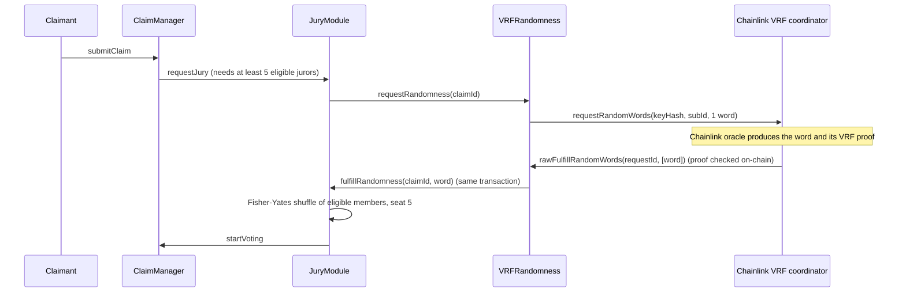

# Jury randomness with Chainlink VRF

Milestone 3 feedback: the backend keeper owned the mock randomness seed and so could bias jury
selection. Trust Pool now draws every jury from **Chainlink VRF v2.5**. This page explains what that
guarantees, how it runs locally and on Sepolia, and how it is tested.

## How a jury is drawn



## What stops anyone from choosing the jury

| Who | Could they pick the seed? | Why not |
|---|---|---|
| Backend keeper / deployer | No | `VRFRandomness` has no owner and no admin function. The old `MockRandomness.fulfill(claimId, seed)` is gone. `JuryModule.fulfillRandomness` only accepts calls from `VRFRandomness`. |
| Deployer swapping the coordinator | No | The coordinator, subscription and key hash are immutable. (Chainlink's own `VRFConsumerBaseV2Plus` lets its owner call `setCoordinator`, which is why we do not inherit it.) |
| Swapping the randomness provider | No | `JuryModule.randomness` is immutable. |
| Re-rolling a bad draw | No | Each request is answered once; `JuryModule` seats a jury only on the first delivery. |
| Members gaming eligibility after seeing the seed | No | The seed is used in the transaction that delivers it, so it is unknown until the jury is already seated. |
| Chainlink's oracle | No | The word comes with a VRF proof that the coordinator verifies on-chain against the registered key. |

The one remaining trust assumption is **liveness**: the VRF subscription owner could stop funding
it. A claim whose randomness never arrives can be cancelled by anyone after one day, with the
claimant's bond returned in full.

Every delivered word is stored in `VRFRandomness.seedOf(claimId)` and emitted in
`RandomnessFulfilled` and `JurySelected`, so anyone can recompute the draw.

## Too few jurors

A jury is always five members. Two cases are covered:

1. **At filing:** `submitClaim` reverts with `NotEnoughEligibleJurors(available, 5)` if fewer than
   five other members are covered, past their waiting period and staked.
2. **While waiting for the seed:** if members cancel or unstake before the word arrives and fewer
   than five remain, no short jury is seated. The claim is marked `starved`, `JuryStarved` is
   emitted, and the claim can be cancelled immediately (no one-day wait), returning the bond.
   Previously the contract quietly seated a smaller jury, possibly of zero.

## Local chain (default)

Nothing to set up. `scripts/deploy.js` (and every test) deploys Chainlink's official
`VRFCoordinatorV2_5Mock`, creates and funds a subscription, and registers `VRFRandomness` as a
consumer. The backend keeper calls the mock's `fulfillRandomWords(requestId, consumer)`, where the
mock derives the word from the request id; the keeper passes no seed.

**Local-only caveat.** There is no Chainlink oracle on a local chain, so the mock lets anyone answer
a request, and its `fulfillRandomWordsWithOverride` lets the caller pick the word (the tests use this
to make draws reproducible). Local runs show the flow; Sepolia shows unbiasable randomness.

## Sepolia (real Chainlink VRF)

You need, once:

1. **An RPC URL** for Sepolia, free from Alchemy or Infura.
2. **A throwaway deployer wallet** with Sepolia ETH from a faucet (about 0.1 ETH covers deployment
   and the demo). Never use a wallet that holds real funds.
3. **A VRF subscription** at [vrf.chain.link](https://vrf.chain.link) on Ethereum Sepolia, created
   from the same wallet as the deployer (so the deploy script can add the consumer for you), and
   funded with test LINK from [faucets.chain.link](https://faucets.chain.link) or with Sepolia ETH.

Then:

```bash
cp .env.example .env
# fill in SEPOLIA_RPC_URL, DEPLOYER_PRIVATE_KEY, VRF_SUBSCRIPTION_ID
# set VRF_NATIVE_PAYMENT=true if you funded the subscription with Sepolia ETH instead of LINK

npx hardhat run scripts/deploy.js --network sepolia
npx hardhat run scripts/sepolia-vrf-demo.js --network sepolia
```

`deploy.js` checks that the key hash is registered on the coordinator and that the subscription
exists before deploying, then adds `VRFRandomness` as a consumer if the deployer owns the
subscription (otherwise it prints what to add on vrf.chain.link). Addresses go to
`deployments/sepolia.json`.

`sepolia-vrf-demo.js` makes six throwaway member wallets (keys saved, git-ignored, in
`deployments/sepolia-demo-wallets.json`), funds each with a little Sepolia ETH for gas, has them buy
policies and stake, files a claim, and waits for Chainlink to answer (usually one to three minutes).
It prints the seed, the coordinator's fulfilment transaction on Etherscan, and the five jurors.

Defaults (override in `.env`): coordinator `0x9DdfaCa8183c41ad55329BdeeD9F6A8d53168B1B`, key hash
`0x787d74caea10b2b357790d5b5247c2f63d1d91572a9846f780606e4d953677ae`, 3 confirmations, 1,000,000
callback gas. Check the current values on Chainlink's
[supported networks](https://docs.chain.link/vrf/v2-5/supported-networks) page if a deploy fails the
key hash check.

The web app and backend still run against the local chain: they rely on unlocked dev accounts and
on fast-forwarding time past voting deadlines, which a public testnet cannot do.

## Tests

* `test/unit/VRFRandomness.test.js`: requests and fulfilment through the coordinator, configuration
  checks, and the manipulation cases from the feedback: the deployer (keeper) key and members cannot
  push a seed or bypass the provider, there is no owner or `setCoordinator`, the consumer link is
  one-time, a request cannot be answered twice, and 40 draws spread across all eligible members.
* `test/unit/JuryModule.test.js` (jury starvation): filing with four eligible jurors reverts; jurors
  lapsing or unstaking before the seed arrives starves the claim instead of seating four, and the
  claim can be cancelled at once.
* `test/unit/ClaimManager.test.js`: a VRF answer arriving after a timed-out claim was cancelled
  cannot seat a jury.
* `backend/test`: the keeper drives the local coordinator mock, and turns itself off where
  Chainlink delivers.
